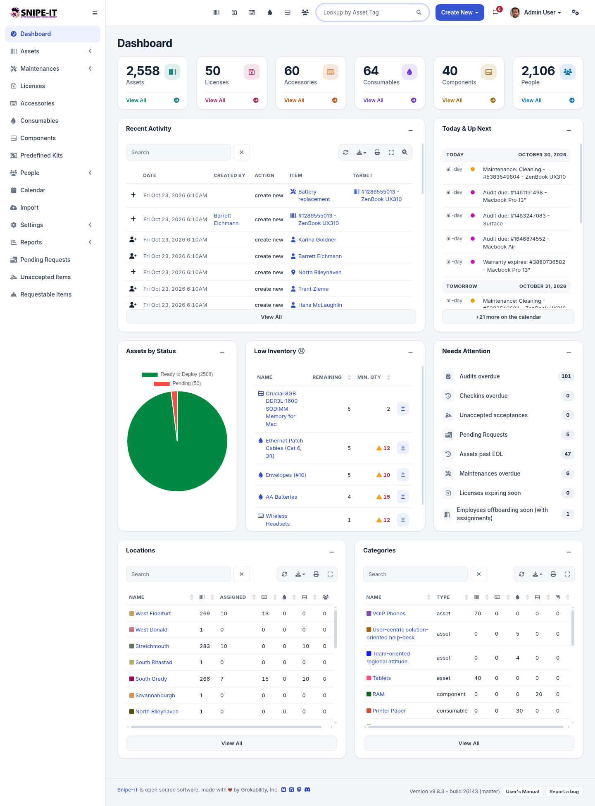
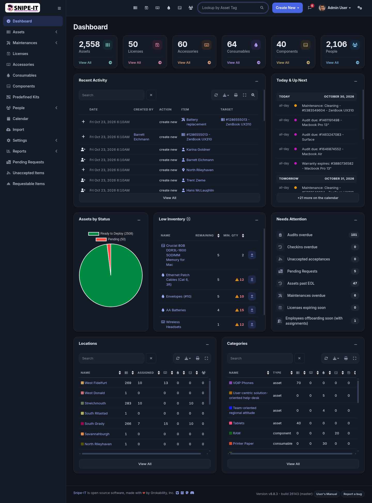

# Porcelain

A Snipe-IT redesign with light and dark modes, cobalt accents, rounded controls and consistent spacing. Covers the dashboard, lists, detail pages, forms, settings, reports, calendar and login screens.

[Install](../../README.md#install) · [CSS file](custom.css)

Tested with **Snipe-IT v8.8.3, build 26143**, in Chromium at 390, 820, 1024 and 1440 px. Uses system sans-serif fonts (Inter when installed) and requires no application source changes. Compatibility with other versions and browsers has not been verified.

## Custom CSS size limit

Porcelain is larger than 65,535 bytes, the default Custom CSS limit in Snipe-IT. Snipe-IT cuts longer CSS without an error, and the theme then shows incorrectly. Raise the limit before you install Porcelain. See [Raise the Custom CSS size limit](../../docs/custom-css-size-limit.md).

## Light and dark mode

Porcelain follows the mode each person selects in Snipe-IT, with the light/dark item in the user menu. If they have not selected one, it follows their operating system setting.

## Branding colours

Enter these values in **Settings → Branding**:

| Setting | Hex code |
| --- | --- |
| Primary Theme Color | `#3454d1` |
| Header Nav Link Color | `#ffffff` |
| Link Color for Light Mode | `#2f4cc0` |
| Link Color for Dark Mode | `#9fb1ff` |

Porcelain applies these colours itself. Matching Branding values keep the parts that Snipe-IT colours on its own in step, such as the mobile browser bar and the colour previews on the Branding page. Personal link colours from a user's profile do not apply while Porcelain is active.

## Logo

The header is white in light mode. In dark mode, the logo sits on a white plate. Use a logo made for a light background. **Logo + Text** works best with a square logo.

## Screenshots

Full-page captures at 1440 px from the official `snipe/snipe-it` Docker image with generated sample data.

| Page | Light | Dark |
| --- | --- | --- |
| Asset list | [View](screenshots/assets.png) | [View](screenshots/assets-dark.png) |
| Asset details | [View](screenshots/asset-details.png) | [View](screenshots/asset-details-dark.png) |
| Create asset | [View](screenshots/asset-create.png) | [View](screenshots/asset-create-dark.png) |
| Calendar | [View](screenshots/calendar.png) | [View](screenshots/calendar-dark.png) |
| Reports | [View](screenshots/reports.png) | [View](screenshots/reports-dark.png) |
| Login | [View](screenshots/login.png) | [View](screenshots/login-dark.png) |
